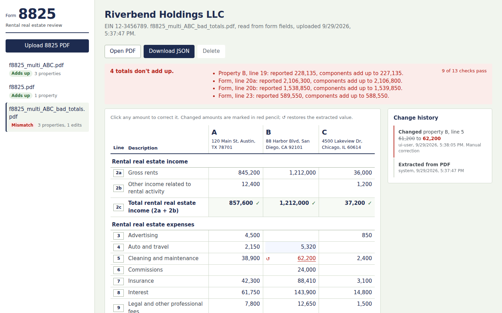

# Form 8825 extraction POC

Extracts income and expenses for every property on IRS Form 8825 (Rev. December 2025), validates the arithmetic, stores results in SQLite, and lets a reviewer correct numbers in a React UI with a full audit trail.

It works on three kinds of input with the same code:

* **Fillable PDFs.** Values sit in form fields, like the provided `f8825.pdf`.
* **Flattened PDFs.** Values are printed text on the page.
* **Scanned PDFs.** The page is an image only, so it is read with OCR.



## Quick start

```bash
# system packages (only needed for scanned PDFs)
#   Ubuntu: sudo apt install tesseract-ocr poppler-utils
#   macOS:  brew install tesseract poppler
pip install -r requirements.txt

# Task 1 - extract one file (prints JSON in the 8825_output.json format)
python -m extractor samples/f8825.pdf -o out/8825_output.json --report out/8825_report.json

# any new file(s): one <name>_output.json + <name>_report.json per input
python -m extractor path/to/*.pdf --out-dir out/

# Task 3 - UI + API
./run.sh                                   # builds the UI, serves everything on http://localhost:8000
# or, for development with hot reload:
python -m uvicorn backend.app.main:app --reload --port 8000
cd frontend && npm install && npm run dev  # http://localhost:5173 (proxies /api to :8000)

# Task 4 - tests
python -m pytest                           # 91 tests: extraction, validation, parsing, API, UI e2e
python tests/run_test_report.py            # CSV results -> test_results/
cd frontend && npm test                    # React component tests (Vitest)
```

The CLI's other options are listed below.

* `--ocr auto|force|off`: `auto` (the default) runs OCR only when a page has no usable text layer.
* `--password`: opens an encrypted PDF.
* `--strict`: the command exits with code 2 if any total doesn't add up.

Exit codes:

* `0`: success.
* `1`: extraction error.
* `2`: validation failure (only with `--strict`).

## Layout

```
extractor/            Task 1-2: document processing (no web dependencies)
  schema.py           line 2a..23 -> JSON key, section, label (single source of truth)
  layout.py           where each cell is on the page + calibration against printed anchors
  sources.py          value tokens from AcroForm widgets, the text layer, or Tesseract OCR
  parse.py            "1,734,896" / "(3,400)" / OCR noise -> int
  validate.py         2c, 18, 19, 20a, 20b, 23, grand total rules
  extract.py          pipeline + error handling; to_output() / to_report()
  cli.py
test_data/            Task 2: generator, source data, generated PDFs + expected JSON, manifest.json
backend/app/          Task 3: FastAPI + SQLAlchemy (SQLite)
frontend/             Task 3: Vite + React review UI
tests/                Task 4: pytest suites, CSV report generator, Playwright UI tests
samples/              the provided f8825.pdf and 8825_output.json
```

## Task 1: extraction

### Finding each value by position, not by field name

When I inspected the sample I found three problems with using its form-field names:

* Values exist only in AcroForm widget `/V` entries. The page text layer contains the printed form but none of the numbers.
* Widget names can't be trusted. Line 14 column A and line 19 column A are both named `...f1_99[0]`.
* Only the 22 filled widgets are registered in `/AcroForm /Fields`. The other ~90 widgets are orphaned on the page.

A mapping by field name is therefore fragile even for this one file, and useless for flattened or scanned returns.

What is stable across every input type is position. The row is the line number and the column is the property. So the extractor works like this:

1. **Collect value tokens with their boxes** from the widgets, the text layer and OCR (`sources.py`).
2. **Calibrate the page layout.** `layout.py` holds the Rev. 12-2025 cell geometry. `calibrate()` finds the printed line labels "2a" … "19" on the actual page. It then shifts and scales the template to match, which absorbs small offsets between revisions, print drivers or scans. The result records how many anchors matched and the leftover error.
3. **Assign each token to the cell** that contains its centre point.
4. **Pick the best source per cell** in the order acroform > text > ocr, then parse the amount. If two sources disagree, for example a stale widget over flattened text, the cell is flagged.

A few details of how the output is built:

* The output format matches `8825_output.json` exactly. Blank lines become `0`.
* Totals are the values reported on the form. If a total line was left blank, the computed value is used and a validation warning is raised.
* The `--report` file adds, for each cell, the raw text, its source, OCR confidence, per-page diagnostics, validation results and warnings.
* Page 2 (properties E onward) is supported. The generated 6-property test file covers it.

### Possible failures and how they're handled

Each failure raises a typed `ExtractionError` with a stable `code`. The CLI prints it and the API returns it as a 422.

| Failure | Detection | Handling (`code`) |
|---|---|---|
| Missing, empty or oversized file | stat before opening; 50 MB / 200 page limits | `input_file_error` |
| Not a PDF (renamed .docx, HTML error page) | no `%PDF-` magic bytes in the first 1 KB | `not_a_pdf` |
| Truncated or corrupt file, broken xref | pypdf/pdfplumber parse errors (pypdf in non-strict mode first, so minor damage is repaired) | `corrupt_pdf` |
| Encrypted PDF | `reader.is_encrypted`; tries the empty password first (owner-password-only files open) | `encrypted_pdf`; `--password` / API retry |
| A valid PDF that isn't an 8825 (or a full 1065 return) | every page is classified from its text; non-8825 pages are skipped, so an 8825 inside a larger return still works | `not_form_8825` if none found |
| Scanned PDF, no text layer | text-layer quality check (below) | OCR; `ocr_unavailable` if Tesseract is missing; `no_text_layer` if OCR is disabled |
| Unmapped fonts (text extracts as `(cid:123)`) | share of CID glyphs | treated as no text layer, so OCR is used |
| Layout shifted (other revision, printer margins, scan offset) | anchor calibration; residual reported | template shifted and scaled; warning if too few anchors are found |
| Unreadable amount ("12a45", OCR noise) | strict amount grammar | value left `null`, cell flagged `needs_review`, warning; never silently 0 |
| Low OCR confidence, odd digit grouping | Tesseract confidence below 0.6; grouping regex | warning and `needs_review` in the UI |
| Negative amounts | `(1,234)`, `-1,234`, trailing minus | parsed as negative; line 20b's printed parentheses are handled |
| Totals that don't add up (preparer error or misread digit) | 2c, 18, 19, 20a, 20b and 23 rules | reported as `fail` checks, not exceptions; the data is still returned |
| One broken page or widget | per-page and per-widget try/except | that page or widget is skipped with a warning; other pages still extract |
| Sample-specific issue: EIN `123-456-78` | format check | warning (an EIN has 9 digits: NN-NNNNNNN) |
| Duplicate upload | SHA-256 of the file | API returns the existing document (`duplicate: true`) |

### How it decides whether the text layer is usable

`sources.text_layer_quality()` checks each page. A page is usable only if all of these hold:

* it has at least 200 characters,
* no more than 10% of them are unmapped `(cid:NNN)` glyphs,
* at least half of the visible characters are letters or digits.

After that, page classification must recognise the text as Form 8825, and calibration must find the printed line anchors. This rejects image-only scans (0 characters), scans with a few stray characters, and PDFs whose fonts have no Unicode map.

The sample's text layer passes (2,853 characters, all 20 anchors matched). The generated scan fails (0 characters, image covering 100% of the page).

### What happens when the text layer isn't usable (implemented)

With `ocr="auto"`, such a page is rendered at 300 DPI (pdf2image) and processed as follows:

1. Tesseract orientation detection rotates 90°, 180° and 270° scans upright.
2. A whole-page OCR pass classifies the page and finds the "2a"…"19" anchors to calibrate the layout.
3. Each cell is read separately. The page is median-filtered to remove specks, and each cell is binarised, has its ruling lines erased, is cropped to the ink and enlarged. Empty cells are skipped without calling Tesseract. Tesseract runs in single-line mode with a digits-only whitelist for amounts.
4. OCR-specific parsing fixes common confusions (O→0, l→1, "1.734.896") and records every fix as a warning.

On the generated noisy 200 DPI scan, all 52 amounts come out correct and validation passes. The only difference is that commas in addresses come out as periods, so the tests compare addresses ignoring punctuation for OCR inputs. It takes about 25 seconds.

A page that has text but no values and is mostly covered by an image (a "hybrid" scan) is also sent to OCR.

### What I'd change for production scanned input

* **Deskew and perspective correction.** Use OpenCV Hough lines or the form's grid to register the page to the template with a homography. The current calibration only corrects shift and scale, so phone photos and skewed scans would drift.
* **Use the grid itself as the layout.** Detecting the table lines would locate cells more reliably than printed labels on poor scans.
* **A stronger OCR engine for handwriting and low quality**, such as PaddleOCR or docTR. A cloud option (Textract, Azure Document Intelligence) is possible if client data policy allows it.
* **Better confidence handling.** Show a cell-level confidence heatmap in the UI and send low-confidence cells to a human reviewer. Because the arithmetic checks tie out, a single misread digit already shows up as a failing total.
* **Performance.** Parallelise per-cell OCR (it's embarrassingly parallel) and cache rendered pages.

## Task 2: multi-property test data

`python test_data/generate_test_pdfs.py` builds everything from one source file, `test_data/source_data.json`, so the PDFs and the expected JSON can't drift apart.

* **Fillable PDFs** are made by filling the real IRS template's widgets, located by position. They behave like the provided sample.
* **Expected JSON** is computed from the same source data. Totals are calculated from the line items, never typed by hand.

| File | Purpose |
|---|---|
| `f8825_multi_ABC.pdf` | properties A, B, C; C has a net loss `(14,840)`; line 21 is a gain and 22a is negative |
| `f8825_multi_ABC_flattened.pdf` | same data as page text, no form fields (text-layer path) |
| `f8825_multi_ABC_scanned.pdf` | image-only 200 DPI scan with blur and speckle noise (OCR path) |
| `f8825_multi_ABC_bad_totals.pdf` | B's line 18 overstated by 1,000 and 20a understated by 500; validation must catch both |
| `f8825_multi_page2.pdf` (+ `_flattened`) | 6 properties: A–D on page 1, E–F on continuation page 2 |
| `f8825_encrypted.pdf`, `f8825_corrupt.pdf`, `not_a_pdf.pdf`, `not_8825.pdf` | failure modes |
| `manifest.json` | each case with its expected output, method, validation status or error code; the tests iterate over it |

## Task 3: database, API, UI

### Tables (SQLite through SQLAlchemy, `backend/app/models.py`)

```
documents    id, filename, sha256, stored_path, status (extracted|failed), error_code, error_message,
             taxpayer_name, ein, extraction_method, page_count, report_json (immutable extractor
             report), created_at, updated_at
properties   id, document_id -> documents, label (A..), address, extracted_address, page, sort_order
             UNIQUE(document_id, label)
line_items   id, document_id, property_id (NULL for form-level lines 20a-23), line_code, field_key,
             section (income|expense|total|reserved|summary), extracted_value, current_value,
             raw_text, source (acroform|text|ocr), confidence, needs_review, is_manual,
             version (optimistic lock), updated_at
             UNIQUE(document_id, property_id, line_code)
audit_log    id, document_id, entity_type (document|property|line_item), entity_id, field,
             action (extracted|failed|updated|reverted), old_value, new_value, actor, reason, created_at
```

Design choices:

* **One row per amount, not one column per line.** This keeps every number individually editable, auditable and lockable. Supporting a new form revision means changing `schema.py`, not the database.
* **`extracted_value` is never overwritten.** Edits change `current_value`, so the original extraction and the reviewed version are always both available. Export supports `?source=extracted|current`.
* **Totals are stored, not only computed.** The reported totals are what's on the form. Validation compares them live against totals recomputed from the current line items, so fixing a misread digit immediately shows whether the form ties out.
* **Failed uploads are recorded too**, with status and error code, so every file the system received is traceable.
* **Optimistic locking.** `PATCH` sends `expected_version`; a stale edit gets a 409 instead of silently overwriting a colleague's change.

### API (`backend/app/main.py`; interactive docs at `/docs`)

| Method | Path | Notes |
|---|---|---|
| GET | `/api/health` | |
| POST | `/api/documents` | multipart `file`; 201 with the extraction; 200 + `duplicate: true` for a re-upload; 422 `{code, message, document_id}` if unreadable; 413 if too large |
| GET | `/api/documents` | list with validation status, grand total, number of manual edits |
| GET | `/api/documents/{id}` | properties, line items (extracted and current values, source, confidence), summary lines, live validation, warnings |
| GET | `/api/documents/{id}/history` | audit trail, newest first |
| GET | `/api/documents/{id}/export?source=current\|extracted` | JSON in the `8825_output.json` format |
| GET | `/api/documents/{id}/file` | the original PDF |
| DELETE | `/api/documents/{id}` | |
| PATCH | `/api/line-items/{id}` | `{value, expected_version, changed_by, reason}`; returns the item, recomputed totals and validation; 409 on version conflict |
| POST | `/api/line-items/{id}/revert` | back to the extracted value (audited as `reverted`) |
| PATCH | `/api/properties/{id}` | `{address}` (audited) |

### UI (`frontend/`)

* **Upload** a PDF by button or drag-and-drop. Failed uploads explain why.
* **Grid** laid out like the printed form: boxed line numbers, one column per property.
* **Editing.** Click any amount to edit; Enter saves and Esc cancels. Input like `12,500`, `(3,400)` and `$1,200` is accepted, and invalid input is rejected inline.
* **Marks.** Edited amounts are marked in red with a ↺ revert button, and the tooltip shows the extracted value. Totals show ✓ when they add up, or ✗ with "should be X" when they don't.
* **Status banner** lists exactly which lines don't add up.
* **Form totals** section shows lines 20a–23 and the grand total net income.
* **Change history** panel, **Download JSON** and **Open PDF**.

## Task 4: tests

| Suite | Covers |
|---|---|
| `tests/test_extraction.py` | 4.1: every field of every property matches the expected JSON for every manifest case (exact match for non-OCR inputs); extraction method; each failure mode raises the right error code; text-layer detection |
| `tests/test_validation.py` | 4.2: lines 2c, 18 and 19 recomputed from line items; grand total; the planted errors in the bad-totals file are flagged on exactly B/18 and 20a; hand-built rule cases |
| `tests/test_parse.py` | amount parsing and OCR corrections |
| `tests/test_api.py` | upload, export equals the expected JSON, edit with audit and revalidation, 409 on a stale version, revert, address audit, duplicates, 422 for bad files, 404s, delete |
| `tests/run_test_report.py` | 4.3: CSV results (below) |
| `tests/ui/test_ui_e2e.py` | 4.4: Playwright against the real API and built UI: every extracted value is shown correctly, editing re-runs validation and appears in history, revert, inline rejection of bad input, JSON download, failed upload |
| `frontend/src/__tests__` | Vitest + Testing Library component tests with a mocked API |

The CSV report writes two files to `test_results/`.

**`test_results.csv`** has one row per check. Columns: `run_id, run_at, test_file, check_type, property, field_or_rule, line, expected, actual, difference, status, extraction_method, notes`. The `check_type` values are:

* `field_match`: each JSON field compared with the expected file.
* `arithmetic`: lines 2c, 18 and 19.
* `form_rule`: lines 20a, 20b, 23 and the grand total.
* `error_handling`: a bad file raised the expected error code.
* `validation`: the file's overall validation result is what was expected.

On the deliberately broken file, a mismatch is the expected result, so it's recorded as PASS with the note "planted error".

**`test_summary.csv`** has one row per file: method, number of properties, checks, passed, failed, seconds.

The latest run: 596 checks across 11 files, all passing.

To run the UI tests:

```bash
cd frontend && npm run build && cd ..
python -m playwright install chromium     # once
python -m pytest tests/ui
```

These tests skip themselves if the UI hasn't been built or Chromium isn't installed. The OCR tests skip themselves if Tesseract is missing.

## What I'd do next

* **Scanned input:** deskew with a homography, grid-line cell detection and a stronger OCR engine (see above). Also add a scanned page-2 test case. Page 2 is tested only for fillable and flattened files, so reading its handwritten property letters by OCR is untested.
* **Line 1 columns (b)–(e):** property type code, other-information code, fair-rental days and personal-use days. The layout cells exist; they need adding to the output schema. **Schedule A (line 17 detail)** and **line 22b** (the pass-through entity list) likewise.
* **More revisions:** a template registry keyed by the revision string printed on the form ("Rev. December 2025"), with a separate geometry file for each revision.
* **Run extraction asynchronously:** a background job queue with a status endpoint, because OCR takes about 25 s per page and shouldn't block the request.
* **Authentication and roles** so `changed_by` is a real user identity, plus a reviewer sign-off state on each document.
* **Move to Postgres with Alembic migrations.** SQLite is fine for the POC but not for concurrent use.
* **Security:** scan uploads for malware, keep PDF parsing in a separate low-privilege worker, and set a retention policy for stored PDFs, which contain taxpayer data.
* **UI:** show the PDF side by side with each cell highlighted on the page, keyboard navigation across cells, and filters for "needs review" and "edited".
